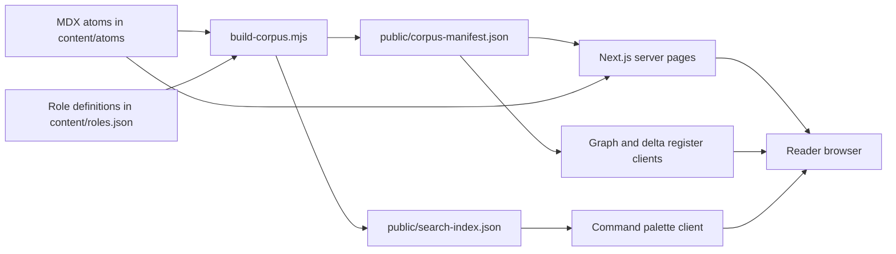
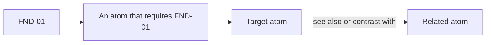

# WARREN — project blueprint

This is a source grounded manual for the repository at the reviewed commit. It explains the implemented learning system and its editorial boundaries. Start with the [short project overview](README.md); use the source links here when changing behavior.

## 1. Product and maturity

WARREN is a banking risk and regulatory knowledge interface. An author writes small MDX units called **atoms**; readers browse by domain, follow prerequisite chains, search text, inspect a graph, and explore role specific reading lists. The product is aimed at practitioners and learners working across banking foundations, credit risk, impairment, capital, treasury, model risk, risk data, Indian lending, business analysis, quantitative methods, and technical skills.

The repository demonstrates an implemented Next.js application and content compiler. It does **not** establish a verified regulatory reference: the checked-in [manifest](public/corpus-manifest.json) has 304 atoms, all `draft` and `verified: false`, with 315 lint notices. Its 629 source entries have labels but no URLs. The app exposes drafts in the reader and flags them. No user research, production usage, content expert review, or live deployment was verified in this audit.

| Checked-in corpus fact | Value | Where to inspect |
| --- | ---: | --- |
| MDX atoms / search entries | 304 / 304 | [`content/atoms/`](content/atoms/), [`search-index.json`](public/search-index.json) |
| Domains / distinct subdomains | 11 / 54 | [`corpus-manifest.json`](public/corpus-manifest.json) |
| Role families | 11 | [`roles.json`](content/roles.json) |
| Draft and unverified atoms | 304 | [`corpus-manifest.json`](public/corpus-manifest.json) |
| Perishable atoms | 257 | [`corpus-manifest.json`](public/corpus-manifest.json) |
| Source labels / populated source URLs | 629 / 0 | [`corpus-manifest.json`](public/corpus-manifest.json) |

These numbers are a snapshot of checked-in files, not a runtime benchmark. Rebuilding the corpus can change generated fields and timestamps.

## 2. System map



The application uses [Next.js App Router](app/), React and TypeScript; [MDXRemote](components/atom/MdxRenderer.tsx) renders the body with GitHub tables and KaTeX math. [Zod](lib/schema.ts) defines atom metadata. The build script uses `gray-matter` and D3 force simulation; the browser graph uses D3 and Canvas. Styling is [Tailwind CSS](app/globals.css). See the exact versions and commands in [`package.json`](package.json).

No database, API backed content editor, login, or analytics pipeline is present. The checked-in JSON files are the client data source; server pages also read the local MDX files. [`getCorpusManifest`](lib/corpus.ts) reads the generated manifest and regenerates it only when missing. The build script is the normal generator and runs through the `prebuild` npm hook.

### Repository guide

| Path | Responsibility |
| --- | --- |
| [`app/`](app/) | Routes, page metadata, sitemap, and global layout. |
| [`components/`](components/) | Shared shell, graph, search, registers, reader elements, studio table. |
| [`lib/schema.ts`](lib/schema.ts) | Frontmatter types, enums, and Zod validation. |
| [`lib/corpus.ts`](lib/corpus.ts) | Manifest loader, prerequisite trail, and role requirement expansion. |
| [`content/atoms/`](content/atoms/) | The 304 checked-in MDX content units. |
| [`content/roles.json`](content/roles.json) | Editorial role families, signal phrases, required atom IDs, weights. |
| [`content/example-jds.json`](content/example-jds.json) | Sample job descriptions; no live matching route is wired to them. |
| [`scripts/`](scripts/) | Corpus compiler, import, scaffold, lint, audit, and suggestion utilities. |
| [`public/`](public/) | Generated manifest and search index, static assets, robots policy. |

## 3. Reader routes and interactions

| Route | Source | Actual behavior |
| --- | --- | --- |
| `/` | [`app/page.tsx`](app/page.tsx) | Graph landing page, corpus counts, role links, illustrative jurisdiction preview. The four preview snippets are hard coded. |
| `/atoms` | [`app/atoms/page.tsx`](app/atoms/page.tsx) | Domain and subdomain index. |
| `/atom/[id]` | [`app/atom/[id]/page.tsx`](app/atom/%5Bid%5D/page.tsx) | Reads matching MDX, displays unverified banner, links, source labels, recall cards, and previous/next atoms. |
| `/path/[id]` | [`app/path/[id]/page.tsx`](app/path/%5Bid%5D/page.tsx) | Deduplicated ancestor path with depth and reading minutes. |
| `/graph` | [`app/graph/page.tsx`](app/graph/page.tsx) | Full interactive corpus graph. |
| `/roles`, `/role/[id]` | [`app/roles/page.tsx`](app/roles/page.tsx), [`role page`](app/role/%5Bid%5D/page.tsx) | Editorial role curricula and prerequisite expansions. No submitted job description is matched. |
| `/deltas`, `/compare/[id]` | [`app/deltas/page.tsx`](app/deltas/page.tsx), [`comparison`](app/compare/%5Bid%5D/page.tsx) | Filters atoms by metadata jurisdiction; comparison extracts structured `<Delta>` blocks. |
| `/currentness` | [`app/currentness/page.tsx`](app/currentness/page.tsx) | Lists perishable atoms and currentness labels from the manifest. |
| `/studio` | [`app/studio/page.tsx`](app/studio/page.tsx) | Development mode only author queue; returns 404 in production. |

The [shell](components/Shell.tsx) provides sidebar, command palette, keyboard controls, and reading progress. Search lazily fetches `search-index.json` and ranks substring hits by ID (100), title (80), summary (40), domain or subdomain (20 each), and body (10); see [`CommandPalette.tsx`](components/CommandPalette.tsx). This is deterministic client side search, not semantic retrieval.

The [jurisdiction context](components/atom/JurisdictionContext.tsx) stores a selected code in a one year `warren_jurisdiction` browser cookie. [`Delta`](components/atom/Delta.tsx) shows a tagged block when the context is `all` or the block's code. The top bar selector in [`Shell.tsx`](components/Shell.tsx) maintains its own state and is not connected to that context. With no `<Delta>` blocks in the checked-in atoms, this interaction has little current content to act on. Recall answers use component state only and are not recorded as learning progress.

## 4. Atom contract and compiler

Each atom has YAML frontmatter and an MDX body. [`CR-07.mdx`](content/atoms/CR-07.mdx) is a representative credit risk example; [`FND-01.mdx`](content/atoms/FND-01.mdx) is a prerequisite root. The authoritative schema is [`lib/schema.ts`](lib/schema.ts), mirrored by the compiler in [`scripts/build-corpus.mjs`](scripts/build-corpus.mjs).

```yaml
---
id: CR-07
title: "Default: defining the event"
type: concept
domain: credit-risk
subdomain: exposure-and-default
one_screen: "A short mental model."
prerequisites: [CR-01, CR-02, CR-05]
see_also: []
contrast_with: []
jurisdictions: [IN, UK, EU, US]
perishable: true
as_of: "2026-08-28"
next_effective_date: "2027-01-01"
status: draft
verified: false
reading_minutes: 3
sources: []
---
```

This is an illustrative **schema shaped** example, not a replacement for the actual CR-07 content. IDs must match the schema's uppercase prefix and numeric suffix pattern. `type` is one of `concept`, `mechanism`, `procedure`, `delta`, `example`, `reference`; `status` is `draft`, `fixture`, or `published`; jurisdictions are `universal`, `IN`, `UK`, `EU`, `US`. A perishable atom requires `as_of`. `verified` is required. Sources accept a label and optional URL and access date.

The compiler reads every `.mdx` file, parses frontmatter, rejects invalid metadata and duplicate IDs, rejects `<OneScreen>` in the body, and prevents prerequisite cycles. It then computes each atom's depth, reverse prerequisite index, domain tree, currentness label, and initial graph coordinates; it indexes role references and emits lint warnings. It writes both JSON files to `public/`. The TypeScript fallback in [`lib/corpus.ts`](lib/corpus.ts) is similar but not identical: it fails missing atom references, while the script collects unresolved atom references without rejecting them and excludes them from cycle and depth walks. The script's `missingAtoms` output covers role requirements. Treat the script output as the normal build path.

In production mode, [`build-corpus.mjs`](scripts/build-corpus.mjs) fails if an atom is `published` and `verified: false`. It does **not** require every visible atom to be verified or every source to have a URL. The current checked-in draft corpus passes that particular gate by status; it is not verified by the gate.

### Currentness calculation

For `perishable: false`, currentness is `durable`. For perishable atoms, a future `next_effective_date` takes precedence; otherwise an `as_of` age of up to 180 days is `fresh`, 181–365 days is `ageing`, and older is `stale`. The code's `buildDate` default is hard coded to **2026-08-28** in both [`build-corpus.mjs`](scripts/build-corpus.mjs) and [`lib/corpus.ts`](lib/corpus.ts). Thus currentness is a prototype classification relative to that date, not a reliable today based regulatory alert. The `as_of` date is editorial metadata, not proof of human verification.

### Graph and reading order



Prerequisites are directed dependencies. The compiler uses depth `0` for roots and `1 + max(parent depth)` otherwise. [`getPrerequisiteTrail`](lib/corpus.ts) recursively collects a target and all ancestors, deduplicates IDs, then sorts by depth and ID; it sums editorial `reading_minutes`. For example, a path to CR-07 includes CR-07 and its direct prerequisites CR-01, CR-02, and CR-05, plus their ancestors. It is a suggested content order, not measured learning effectiveness.

The build script seeds domain centroids on a circle and runs a D3 force simulation to store initial coordinates. [`CorpusGraph.tsx`](components/CorpusGraph.tsx) runs its own browser simulation and Canvas drawing. It draws prerequisite edges plus deduplicated `see_also` and `contrast_with` edges, and offers zoom, domain selection, and search highlighting. The related edges are discovery links, not prerequisites in the DAG.

### Role curricula

[`roles.json`](content/roles.json) provides editorial atom requirements weighted 1, 2, or 3, jurisdiction hints, and signal phrases. [`buildRequirementSet`](lib/corpus.ts) takes up to three supplied role matches, keeps the highest weight for repeated target atoms, adds prerequisite ancestors, separates covered IDs from missing IDs, sorts by depth then weight and ID, and totals reading minutes. The current role pages pass a single constructed match for the selected role. The presence of signal phrases and [`example-jds.json`](content/example-jds.json) does not mean the UI performs job description matching or user skill assessment. The displayed coverage percentage measures whether required IDs exist in the corpus, not verified expertise.

## 5. Authoring and local workflow

Requirements: Node.js and npm compatible with the versions in [`package.json`](package.json). No credentials or external database are needed for the local corpus. The workflow below describes repository commands; this documentation audit deliberately did not install dependencies or run a build.

```bash
npm ci
npm run dev
npm run build-corpus
npm test
npm run lint
npm run build
```

`npm run build` invokes `prebuild` first, generating the manifest and search index before Next.js builds. `npm run start` serves a production build. The [Next config](next.config.ts) does not set `output: "export"`; do not assume an `/out` directory or a fully static deployment from the existing configuration. The [sitemap](app/sitemap.ts) and [`robots.txt`](public/robots.txt) contain a Vercel URL, but deployment availability was not checked.

To add an atom, choose an unused ID, create `content/atoms/<ID>.mdx`, follow the [schema](lib/schema.ts), include `verified: false`, and supply real provenance as it is reviewed. Add valid prerequisite IDs and optional related links. Run `npm run build-corpus`, inspect manifest warnings, and review the reader, path, and search entries. Keep `published` and `verified` decisions under human expert control.

```bash
npm run new-atom -- --id CR-99 --domain credit-risk --subdomain exposure-and-default
```

**Scaffold caveat:** [`scripts/new-atom.mjs`](scripts/new-atom.mjs) currently omits the mandatory `verified` field, so its output will fail corpus validation until you add `verified: false`. Its sample body also demonstrates components such as `Flow`, `Rule`, and `Formula` that are not registered by the current [`MdxRenderer`](components/atom/MdxRenderer.tsx); author against supported components or verify rendering before use. The importer scripts expect ignored `_import/` material and support dry run or write flags; see [`import-markdown.mjs`](scripts/import-markdown.mjs) and [`import-pack.mjs`](scripts/import-pack.mjs). Those original import sources are not present in this clone.

The [`/studio` page](app/studio/page.tsx) reads raw atoms, counts marked claims, known errors, word counts, and component tags, then gives a six point heuristic completeness score. It is an author review aid, not an editor or a factual validator. [`corpus-stats.mjs`](scripts/corpus-stats.mjs), [`audit-formatting.mjs`](scripts/audit-formatting.mjs), and [`full-audit.mjs`](scripts/full-audit.mjs) are additional local scripts; inspect their inputs before running them. The small [`Vitest suite`](lib/corpus.test.ts) checks manifest shape and prerequisite ordering, not financial correctness or deployment behavior.

## 6. Trust, privacy, and operational limits

| Boundary | Consequence |
| --- | --- |
| All 304 atoms are `draft` and unverified. | Reader warnings are essential; source claims need expert review before professional use. |
| 629 source labels, zero populated URLs in the checked-in manifest. | Citation display is a reading lead, not clickable evidence or an audited source trail. |
| No structured `<Delta>` blocks in the checked-in MDX. | The comparison route mostly shows the common body and “no variant” cards even where jurisdiction metadata exists; jurisdiction prose may still appear in the common body. |
| Fixed currentness reference date. | “Fresh”, “future”, and “stale” labels can drift from real time. |
| Home preview snippets and some page copy are hard coded. | Treat them as illustrative UI content; counts or regulatory wording can diverge from the corpus. |
| No account or server persistence layer. | The jurisdiction context uses a browser cookie; recall reveals are in memory. No individual progress is saved. |
| Studio is hidden by `NODE_ENV === "production"`. | It is not an authenticated editorial service. Development access is local application access. |
| Corpus and search are generated files. | Edit MDX and roles, then regenerate JSON; hand edits to generated files can be overwritten. |

The repository has no credential handling flow. Do not paste personal or confidential banking data into atom files or public JSON. [`robots.txt`](public/robots.txt) disallows `/studio`, but that is crawler guidance, not access control. The schema and production gate enforce structure and a narrow publication rule; they cannot validate the legal or financial truth of an atom.

### Troubleshooting

| Symptom | Likely check |
| --- | --- |
| Atom absent from reader or search | Confirm MDX ID and filename, run `npm run build-corpus`, inspect both generated JSON files. |
| Compiler rejects frontmatter | Check required `verified`, valid enum values, `reading_minutes`, and `as_of` for perishable atoms against [`schema.ts`](lib/schema.ts). |
| Compiler reports a cycle | Follow `prerequisites` links and remove the circular dependency. Related links do not define learning depth. |
| Search appears stale | Regenerate `public/search-index.json`; reload the browser so the lazy client fetch gets the new file. |
| Comparison cards show no variants | Current MDX lacks `<Delta j="IN|UK|EU|US">...</Delta>` blocks; metadata alone does not populate cards. |
| Studio returns 404 | The route intentionally calls `notFound()` when `NODE_ENV=production`. |
| Currentness looks wrong | Compare labels with the fixed date in the compiler; do not treat them as live alerts. |

## 7. Sensible next steps

First, establish human review and direct primary source links, with a documented change log per atom. Then align `new-atom` with the schema and renderer, connect the shell selector to the jurisdiction context, and migrate jurisdiction prose into structured delta blocks where comparisons truly differ. Replace the fixed currentness clock with an explicit, testable reference date and reconsider which drafts should be publicly browsable. Add tests for these behaviors as they are implemented. These are extension opportunities, not claims about current functionality.
